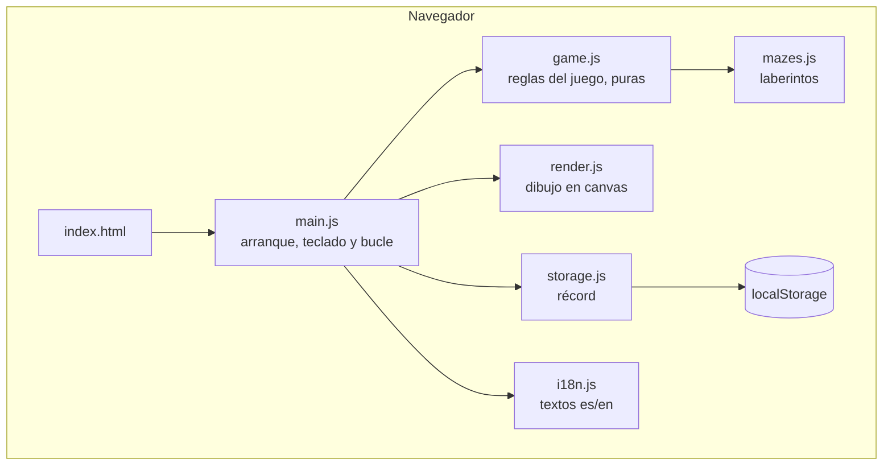
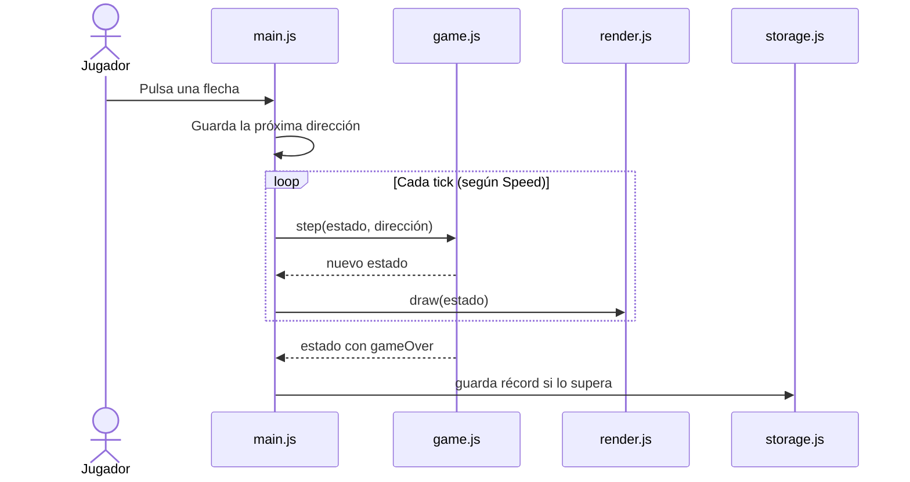

# Snake App — Arquitectura

> Vista de alto nivel de cómo está construido el sistema y cómo se reparten las
> responsabilidades. Para el stack real (versiones, librerías) ver
> [`stack.md`](stack.md). Para el negocio ver
> [`../product/business-model.md`](../product/business-model.md).
>
> **Última actualización**: 2026-10-13

## Diagrama

Todo corre en el navegador. No hay servidor de aplicación: el hosting solo entrega
archivos.

## Componentes

| Componente   | Responsabilidad                                                                                                                      | Tecnología                    |
| ------------ | ------------------------------------------------------------------------------------------------------------------------------------ | ----------------------------- |
| `game.js`    | Estado de la partida y sus reglas: mover, crecer, comer, chocar, subir velocidad. **Sin DOM**                                        | JavaScript puro               |
| `render.js`  | Dibuja un estado en el canvas: fondo LCD, puntos de la serpiente y la comida, y los números del marcador como mapa de bits de puntos | Canvas 2D                     |
| `main.js`    | Arranca la página, lleva el menú de inicio, traduce teclado y gestos a direcciones y avanza el juego a ritmo de la velocidad         | DOM + `requestAnimationFrame` |
| `mazes.js`   | Los laberintos como datos: filas de texto, `#` = muro. Validados por `tests/mazes.test.js`                                           | Datos                         |
| `storage.js` | Lee y guarda el récord por laberinto, el laberinto elegido y el idioma                                                               | `localStorage`                |
| `i18n.js`    | Diccionario es/en y elección de idioma                                                                                               | JavaScript puro               |

## Decisiones clave

| Decisión                                                  | Razón                                                                                                     |
| --------------------------------------------------------- | --------------------------------------------------------------------------------------------------------- |
| Las reglas viven en `game.js`, separadas del dibujo       | Se prueban con `node --test` sin navegador, y el render puede cambiar sin tocar las reglas                |
| `game.js` es una función de paso: `step(estado) → estado` | Determinista: una prueba fija el estado inicial y la semilla de la comida y comprueba el resultado exacto |
| Tick fijo según la velocidad, no por frame                | La serpiente se mueve igual en una pantalla de 60 Hz que en una de 120 Hz                                 |
| Canvas en vez de DOM para el tablero                      | Cientos de celdas redibujadas varias veces por segundo; el DOM no está hecho para eso                     |

> El detalle y las alternativas de cada decisión relevante se registran como
> ADRs en [`../decisions/`](../decisions/README.md).

## Reglas no negociables

- `game.js` no toca el DOM, `window` ni `localStorage`. Si una regla del juego necesita
  algo del navegador, lo recibe como parámetro.
- La aleatoriedad (posición de la comida) entra inyectada, para que las pruebas sean
  reproducibles.
- Sin dependencias en tiempo de ejecución: nada que se descargue de un CDN.

## Flujos principales

## Referencias

- [`stack.md`](stack.md) — stack tecnológico y versiones.
- [`database.md`](database.md) — qué se guarda en el navegador.
- [`auth.md`](auth.md) — por qué no hay autenticación.
- [`api.md`](api.md) — por qué no hay API.
- [`screens.md`](screens.md) — la pantalla y su recorrido.
- [`../conventions/`](../conventions/README.md) — convenciones de trabajo.
