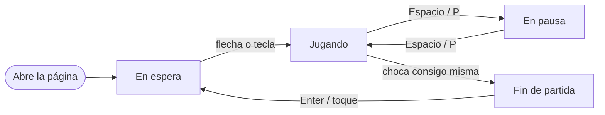

# Mapa de pantallas — Snake App

> Qué pantallas tiene el producto, para qué sirve cada una y **por dónde va**. Es la
> salida del paso "Mapear" del sprint de definición
> ([`../conventions/workflow.md`](../conventions/workflow.md)) y el tablero de avance de
> la UI: se actualiza cada vez que una vista cambia de estado.
>
> Aquí **no** se decide cómo se ve (eso es [`design/`](../../design/README.md)) ni cómo
> se organiza el código de las vistas (eso es
> [`../conventions/ui.md`](../conventions/ui.md)). Las decisiones de diseño de un cambio
> concreto van en el `design.md` de su spec; las duraderas, en un
> [ADR](../decisions/README.md).
>
> **Última actualización**: 2026-10-13

## Estados

| Estado        | Significa                                                       |
| ------------- | --------------------------------------------------------------- |
| **mapa**      | Existe la decisión de que haga falta. Nada construido.          |
| **prototipo** | Maquetada en estático con `/prototipo`, navegable y criticable. |
| **conectada** | Con datos reales, sus cuatro estados y revisada en ambos temas. |

Una vista no pasa a **conectada** sin loading, empty, error y éxito — ver
[`../conventions/ui.md`](../conventions/ui.md).

## Pantallas

Una sola ruta. Lo que cambia no es la pantalla, sino el estado del juego dentro de ella:
la barra de marcador (Score · Speed · Record) está siempre visible.

| Vista             | Ruta | Propósito                                                               | Estado |
| ----------------- | ---- | ----------------------------------------------------------------------- | ------ |
| Juego — en espera | `/`  | Tablero vacío con la serpiente inicial y «pulsa una tecla para empezar» | mapa   |
| Juego — jugando   | `/`  | La partida: serpiente, comida y marcador en vivo                        | mapa   |
| Juego — en pausa  | `/`  | Tablero congelado y aviso de pausa                                      | mapa   |
| Juego — fin       | `/`  | Puntuación final, aviso de récord nuevo y cómo volver a jugar           | mapa   |

## Mapa de navegación

## Recorrido crítico

El camino que la v1 debe hacer impecable, en orden:

En espera → Jugando → Fin de partida → En espera (con el récord actualizado)

## Pantallas que no van a existir

| Vista descartada                    | Por qué                                                    | ¿Qué señal la haría entrar?          |
| ----------------------------------- | ---------------------------------------------------------- | ------------------------------------ |
| Registro / login                    | No hay cuentas en la v1                                    | Que se pida un ranking online        |
| Ranking global                      | Exige backend y defensa contra puntuaciones falsas         | Que haya gente jugando y pidiéndolo  |
| Privacidad / cookies                | No se recogen datos personales ni hay cookies ni analítica | Añadir analítica, anuncios o cuentas |
| Menú de opciones (laberintos, etc.) | La v1 replica la pantalla de juego, no el menú del móvil   | Que la v1 esté terminada y se juegue |
